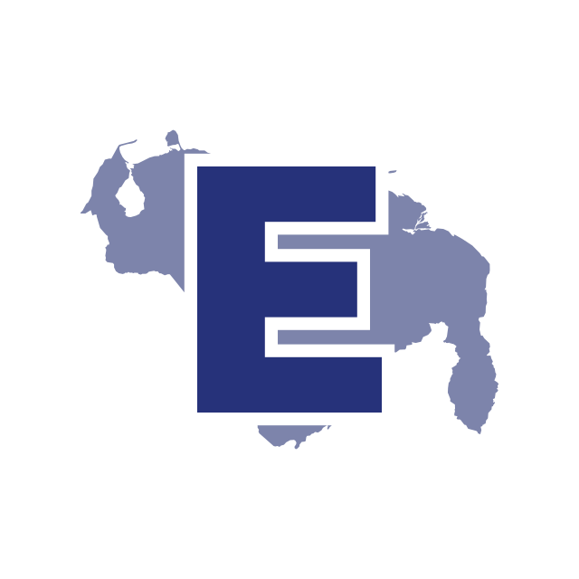
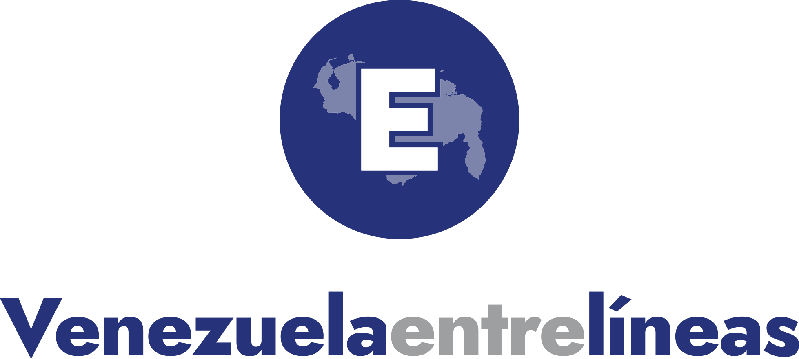
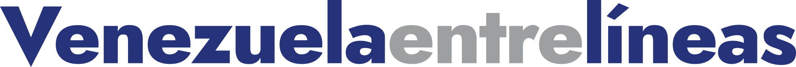
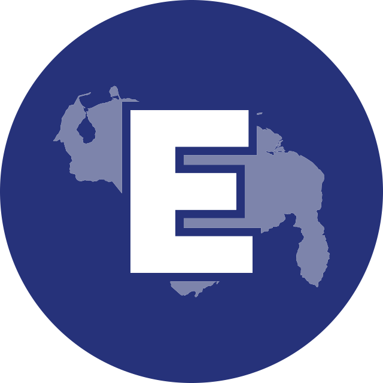
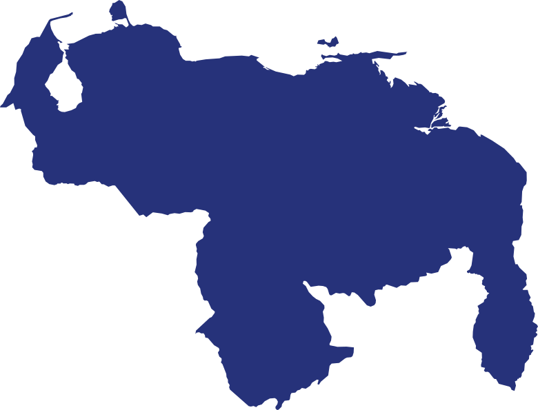

Si vas a publicar una nota sobre nosotros, hacer una pieza con tu organización o compartir nuestro trabajo, aquí tienes los archivos oficiales. Úsalos tal cual: no hace falta redibujar nada.

  
  
<strong>Nuestro símbolo</strong> une la E de Entrelíneas con el mapa de Venezuela, completo con la Guayana Esequiba. El mapa viene del logo de la Fundación Entre Líneas de 2003, que ponía a Venezuela «entre líneas» con el lema <em>Grandes líneas para una Venezuela mejor</em>.

<a class="btn" href="/assets/marca/venezuela-entrelineas_logos.zip" download>Descargar todos los logos (ZIP, 2 MB)</a>

## Logos

  

Imagotipo horizontal

<a href="/assets/marca/venezuela-entrelineas_imagotipo-horizontal_color.svg" download>SVG</a><a href="/assets/marca/venezuela-entrelineas_imagotipo-horizontal_color.png" download>PNG</a>

  

Imagotipo horizontal, negativo

<a href="/assets/marca/venezuela-entrelineas_imagotipo-horizontal_negativo.svg" download>SVG</a><a href="/assets/marca/venezuela-entrelineas_imagotipo-horizontal_negativo.png" download>PNG</a>

  

Imagotipo vertical

<a href="/assets/marca/venezuela-entrelineas_imagotipo-vertical_color.svg" download>SVG</a><a href="/assets/marca/venezuela-entrelineas_imagotipo-vertical_color.png" download>PNG</a>

  

Imagotipo vertical, negativo

<a href="/assets/marca/venezuela-entrelineas_imagotipo-vertical_negativo.svg" download>SVG</a><a href="/assets/marca/venezuela-entrelineas_imagotipo-vertical_negativo.png" download>PNG</a>

  

Logotipo

<a href="/assets/marca/venezuela-entrelineas_logotipo_color.svg" download>SVG</a><a href="/assets/marca/venezuela-entrelineas_logotipo_color.png" download>PNG</a>

  

Logotipo con lema

<a href="/assets/marca/venezuela-entrelineas_logotipo-con-lema_color.svg" download>SVG</a><a href="/assets/marca/venezuela-entrelineas_logotipo-con-lema_color.png" download>PNG</a>

  

Símbolo

<a href="/assets/marca/venezuela-entrelineas_simbolo_color.svg" download>SVG</a><a href="/assets/marca/venezuela-entrelineas_simbolo_color.png" download>PNG</a><a href="/assets/marca/venezuela-entrelineas_avatar-simbolo_1080x1080.png" download>Avatar</a>

  

Símbolo reducido (menos de 40 px)

<a href="/assets/marca/venezuela-entrelineas_simbolo-reducido_color.svg" download>SVG</a><a href="/assets/marca/venezuela-entrelineas_simbolo-reducido_color.png" download>PNG</a>

  

Mapa de Venezuela

<a href="/assets/marca/venezuela-entrelineas_mapa-venezuela_azul-rey.svg" download>SVG</a><a href="/assets/marca/venezuela-entrelineas_mapa-venezuela_azul-rey.png" download>PNG</a><a href="/assets/marca/venezuela-entrelineas_mapa-venezuela_rayado-zona-en-reclamacion_azul-rey.svg" download>Con zona rayada</a>

El ZIP trae además las versiones en monocromo, escala de grises, negro y blanco, y los PDF en CMYK para imprenta.

## Reglas básicas

- **No deformes, inclines ni cambies los colores** del logo o del símbolo.
- **Deja aire alrededor**: como mínimo, el alto de una letra minúscula del logotipo.
- **Sobre fondos oscuros o fotos**, usa la versión en negativo.
- **El mapa de Venezuela siempre incluye la Guayana Esequiba.** No uses mapas que la dejen fuera.
- **En tamaños muy pequeños** (menos de 40 px), usa el símbolo reducido: la E sola.
- **En texto corrido**, el nombre se escribe en dos palabras: Venezuela Entrelíneas.

## Colores

  
<i style="background:#26327A"></i><b>Azul rey</b>#26327A

  
<i style="background:#9E9FA1"></i><b>Gris entre</b>#9E9FA1

  
<i style="background:#7D84AB"></i><b>Azul niebla</b>#7D84AB · solo el mapa

  
<i style="background:#0091D9"></i><b>Azul claro</b>#0091D9

  
<i style="background:#F2C31B"></i><b>Oro</b>#F2C31B · franja tricolor

  
<i style="background:#C8102E"></i><b>Rojo</b>#C8102E · franja tricolor

Las letras de la marca son **Jost** (logotipo y titulares), **Montserrat** (menús y etiquetas) y **Source Serif 4** (textos). Las tres son libres y están en Google Fonts.

  
<strong>¿Necesitas otro formato o el manual de marca completo?</strong> Escríbenos a <a href="mailto:contacto@venezuelaentrelineas.com">contacto@venezuelaentrelineas.com</a>.

